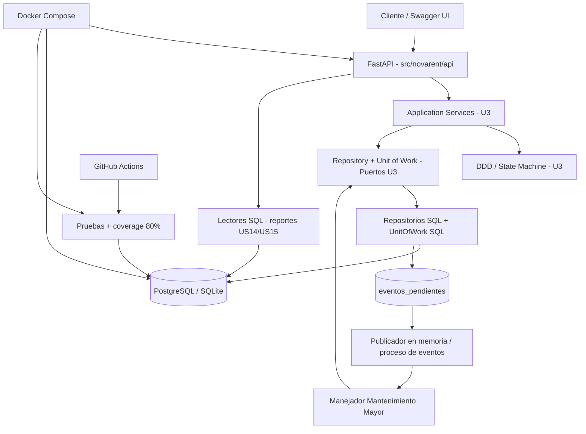

# Diagrama de arquitectura de infraestructura - PIA

Diagrama de despliegue y capas compatible con el codigo (sugerido para
integrar en los diagramas UML del Integrante 1).

**Decisiones:** dependencia hacia adentro (dominio sin SQL/HTTP); una unidad de
trabajo por caso de uso; concurrencia optimista por version; eventos despues
del commit; CQRS sencillo, consultas en la misma base. La API no implementa
las formulas de cargos, solo llama al servicio existente.

Los directorios `src/domain`, `src/application`, `src/infrastructure` y
`src/api` son alias de compatibilidad con la estructura minima del PIA;
la fuente canonica se conserva en `src/novarent/` por continuidad U3.
